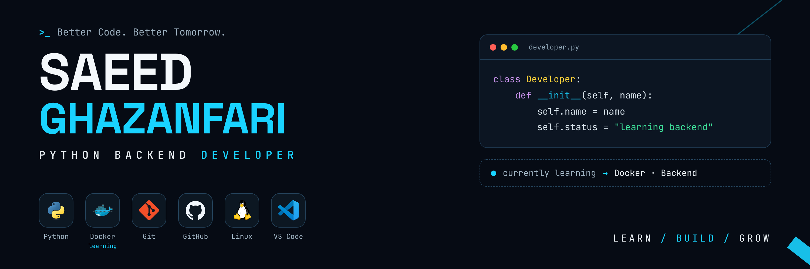

  

<h1 align="center">Hi, I'm Saeed Ghazanfari 👋</h1>

<strong>Aspiring Python Backend Developer</strong>

  I'm learning Python step by step with <em>Python Crash Course, 3rd Edition</em>.
  I practice by writing small programs, understanding the fundamentals, and improving a little at a time.

---

## About Me

- 🌱 Studying Python fundamentals and working through *Python Crash Course, 3rd Edition*.
- 🐧 Learning Linux on Fedora with LPIC-1 study materials.
- 🔧 Studying Git with the book *Pro Git* and practicing with GitHub.
- 🎯 My long-term goal is to build backend applications with Python.

## Skills & Tools

**Beginner — actively learning:**  
`Python fundamentals`

**Intermediate — building practical experience:**  
`Git` · `GitHub` · `Linux (Fedora)`

**On my learning roadmap:**  
`Functions and OOP` · `SQL / PostgreSQL` · `FastAPI` · `Django` · `Docker`

I will update these levels as I gain more hands-on experience.

## Learning Resources

- **Python:** [*Python Crash Course, 3rd Edition* — official publisher page](https://nostarch.com/node/691) — currently studying Python fundamentals and practicing chapter exercises.
- **Linux:** [LPIC-1 — official overview and exam objectives](https://www.lpi.org/our-certifications/lpic-1-overview/) — learning Linux concepts and command-line skills on Fedora.
- **Git:** [*Pro Git* — read the book online for free](https://git-scm.com/book/en/v2.html) — learning version control concepts and practicing Git workflows.

## Beginner Practice Project

### Python Study Topics Menu

A small command-line exercise based on the Python concepts I am currently studying. It lets a user display, add, and remove study topics using lists, strings, conditions, and loops.

- [View the project](./projects/python-study-topics/)
- [Read its README](./projects/python-study-topics/README.md)

This is a learning exercise, not a claim of professional experience. I plan to improve it as I learn more Python.

## Learning Next

- Continue through *Python Crash Course*
- Learn functions and object-oriented programming
- Practice SQL and PostgreSQL
- Build my first REST API when my Python fundamentals are ready

## Contact

- Email: [saeed.ghazanfarni.dev@gmail.com](mailto:saeed.ghazanfarni.dev@gmail.com)

---

Learn · Build · Improve

